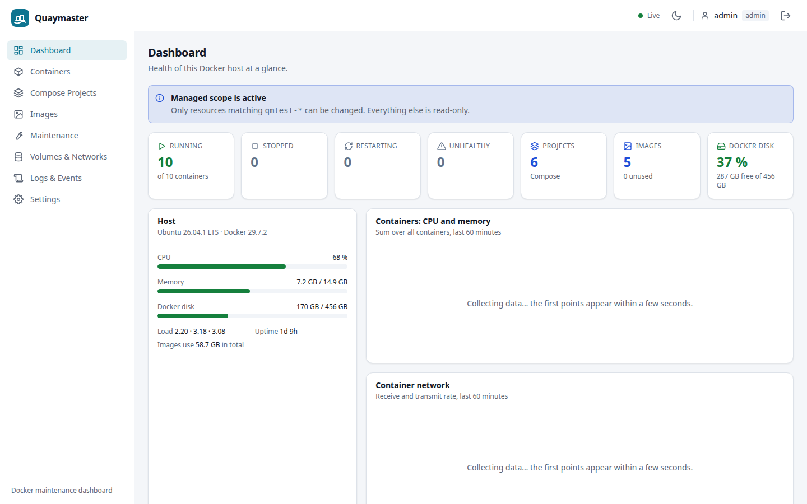
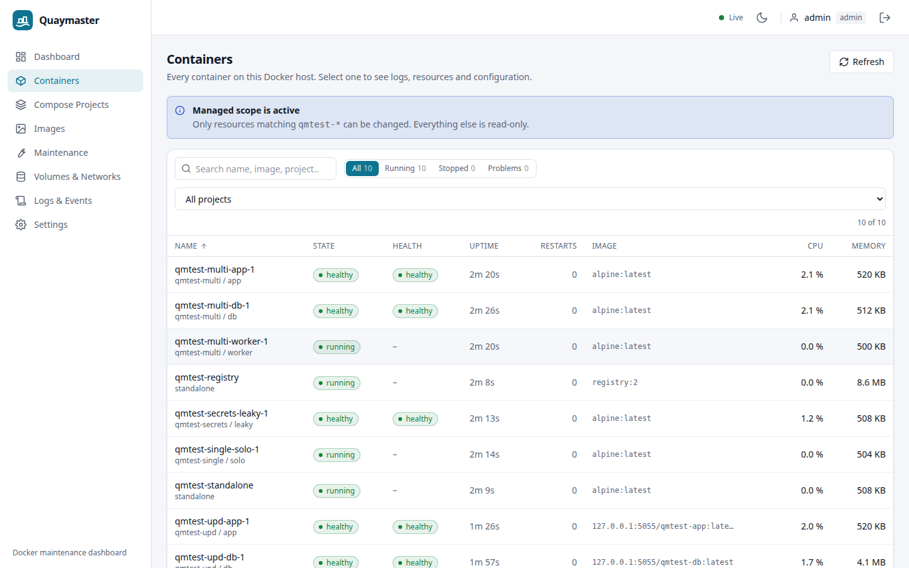
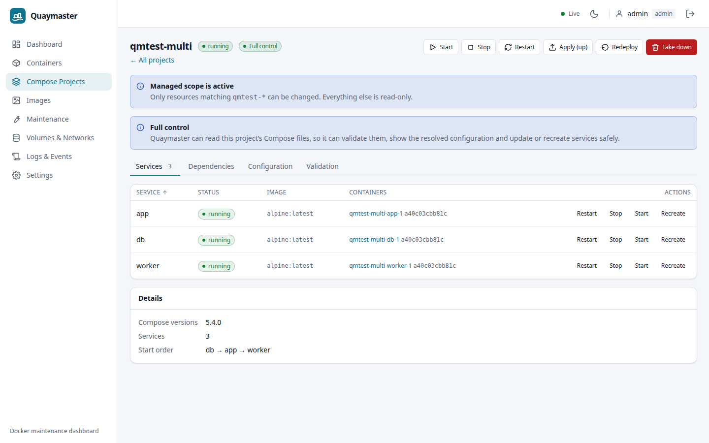
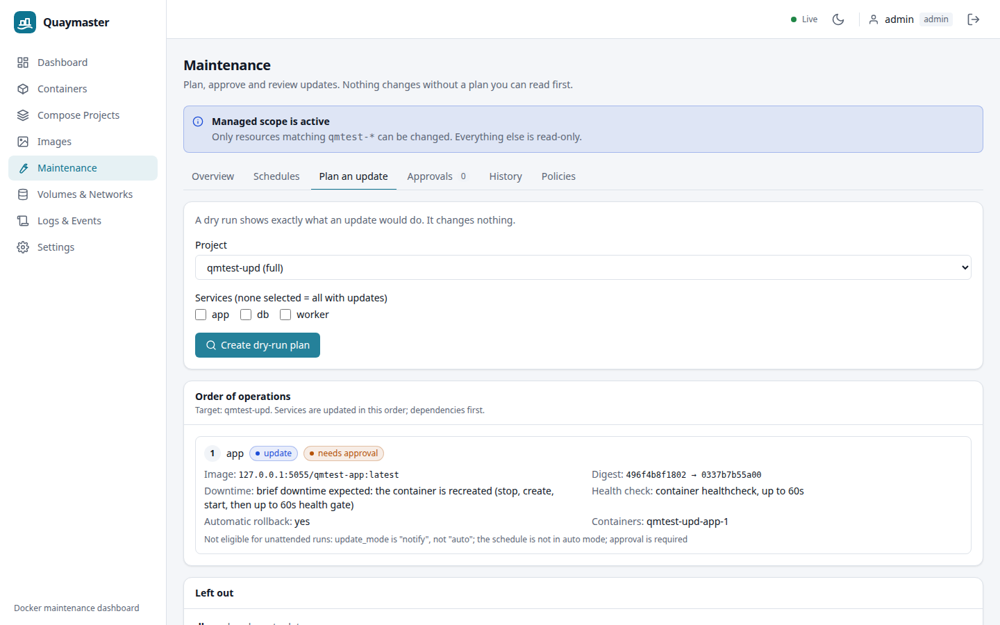
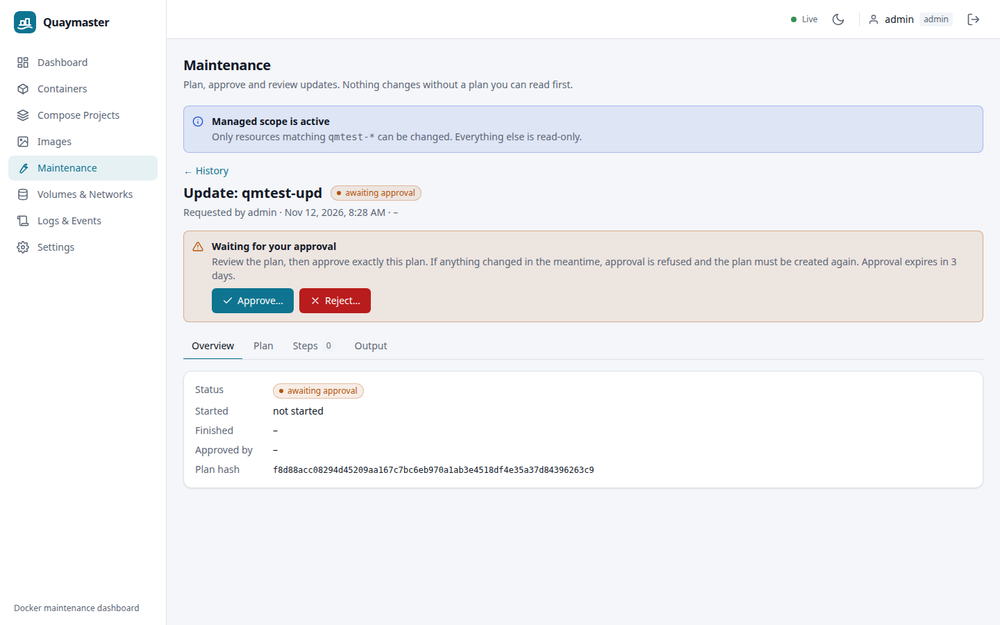
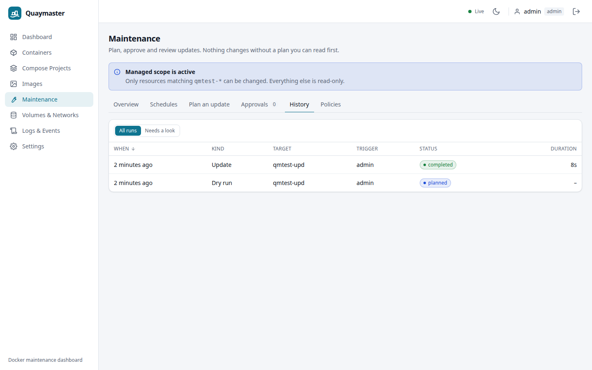
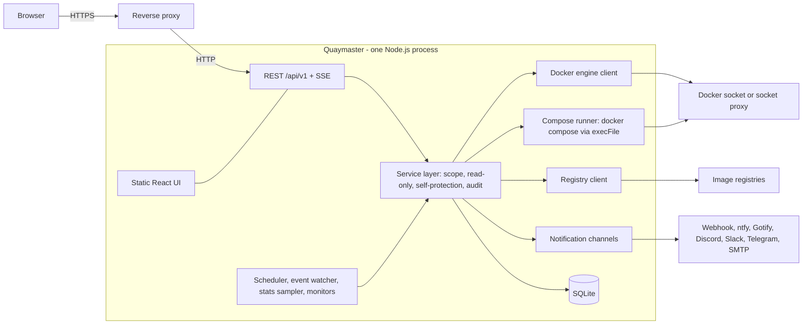

# Quaymaster

Quaymaster is a self-hosted web dashboard for monitoring, managing and safely maintaining Docker on a single
Linux home server. It shows containers, Compose projects, images, volumes and networks, and it runs image updates
through a controlled workflow: a dry-run plan, explicit approval, dependency-ordered rollout, health checks,
automatic rollback of the image where that is safe, and an audit trail for everything. Automation is opt-in; the
default is to notify and ask.

> **Status: 0.1.0, single host.** Docker socket access is root-equivalent on the host. Read the
> [security model](#security-model) before you deploy. Do not expose Quaymaster to the internet.

|                                                          |                                                            |
| -------------------------------------------------------- | ---------------------------------------------------------- |
|              |              |
|  |  |
|    |            |

More: [container detail](docs/screenshots/container-detail.png), [logs](docs/screenshots/container-logs.png),
[images](docs/screenshots/images.png), [settings](docs/screenshots/settings.png),
[mobile](docs/screenshots/mobile-containers.png). All screenshots show throw-away demo containers.

## Contents

[Features](#features) · [Safe update workflow](#safe-update-workflow) · [Security model](#security-model) ·
[Architecture](#architecture) · [Quick start](#quick-start) · [Native install](#native-install-systemd) ·
[Configuration](#configuration) · [Examples](#configuration-examples) · [Backup and restore](#backup-and-restore) ·
[Upgrading](#upgrading) · [Troubleshooting](#troubleshooting-and-faq) · [Development](#development) ·
[Limitations and roadmap](#limitations-and-roadmap) · [License](#license)

More documentation: [INSTALL](docs/INSTALL.md) · [CONFIGURATION](docs/CONFIGURATION.md) ·
[OPERATIONS](docs/OPERATIONS.md) · [MAINTENANCE](docs/MAINTENANCE.md) · [SECURITY-MODEL](docs/SECURITY-MODEL.md) ·
[API](docs/API.md) · [ARCHITECTURE](docs/ARCHITECTURE.md) · [DECISIONS](docs/DECISIONS.md)

## Features

- **Dashboard** with host CPU, memory, load, Docker disk usage and free space on the Docker root.
- **Containers:** state, health, ports, mounts, networks, redacted environment and labels, live and historical
  CPU/memory/network/IO, live logs, start/stop/restart/kill/pause/unpause/remove/recreate.
- **Compose projects:** discovered from container labels, `docker compose ls` and a read-only scan of your stack
  directories (projects that are down stay visible). Dependency graph, validated and redacted resolved config,
  up/stop/start/restart/down/redeploy. Quaymaster never edits your Compose files.
- **Images:** update detection by registry digest (HEAD request, throttled, cached), staged pulls, cleanup with a
  mandatory preview.
- **Volumes and networks:** inventory and usage. Removal is report-only.
- **Maintenance:** policies, maintenance windows, cron schedules, plans (dry run), approvals, run history with
  per-step output, one-click restore of a run's recovery points.
- **Notifications:** webhook (optional HMAC signature), ntfy, Gotify, Discord, Slack, Telegram, SMTP. Per-channel event
  list and minimum severity, de-duplication and cool-down, delivery log with retry.
- **Monitors:** container died/unhealthy/restart loop, updates available, upcoming maintenance, low disk, high CPU/memory.
- **Logs and events:** Docker event history, and an append-only audit log for admins.
- **Users:** `admin` and `viewer` roles. Container log access is a separate per-user permission, off for viewers.
- Light and dark themes, responsive layout, keyboard-accessible tables and dialogs.

## Safe update workflow

An update changes **only the image** of a service. Everything else about the service must already match your Compose
files. Every step of a run is persisted, so you can read afterwards what happened.

1. **Preflight.** Current state of the project; refuse if a service is restarting or unhealthy; check free space on
   the Docker root (fails closed if free space cannot be measured).
2. **Validate.** `docker compose config` must pass. The per-service config hash is compared with the running
   container. If your files drifted from what is running, an automatic run stops (`blocked_drift`). A manual run needs a
   separate, explicit confirmation that shows a redacted diff.
3. **Check.** Registry digests for the affected images.
4. **Recovery point.** The image ID of the running container is recorded and tagged `quaymaster-rollback/…`, so it
   cannot be pruned. Compose file hashes and a redacted config snapshot are stored.
5. **Pull.** By digest, into a `quaymaster-staged/…` tag. The tag you use does not move yet. A failed pull aborts with
   no impact on running containers.
6. **Impact.** Affected services and their dependents, expected downtime, attached volumes, critical flags, and every
   other container on the host that uses the same tag.
7. **Deploy.** One service at a time, dependencies first: `docker compose up -d --no-deps` with `--no-build --pull never`.
   Afterwards the running image ID is asserted.
8. **Health.** Waits for `healthy` if the service has a healthcheck; otherwise for "running, not restarting, restart
   count stable". An optional HTTP probe runs from the server.
9. **Confirm or roll back.** On failure the rollout stops and the remaining services are skipped. If auto-rollback
   applies, the previous image ID is re-tagged, the service is redeployed and health is checked again.
10. **Record and notify.** Result, steps, durations, audit entries, notifications.

**Dry run** runs the read-only steps (preflight, validate, check, impact) and shows the plan. Nothing is pulled or
changed. Every real run stores the plan it executed.

**Approval.** By default a run waits for an admin. The approval is bound to a hash of the plan: if anything in the plan
changed before execution, the run ends `approval_stale` and is never executed. Approvals expire after
`QM_APPROVAL_EXPIRY_HOURS` (default 72).

**Unattended updates** happen only when all four hold: the policy's update mode is `auto`, the schedule's mode is
`auto`, approval is not required, and the target is not marked `critical`. Critical targets always need approval.

### Honest limits

- **Brief downtime.** Compose on one host recreates a container in place. Expect a short interruption per updated
  service. Quaymaster says "brief downtime expected"; it does not claim zero downtime.
- **Rollback restores the image, not the data.** If a new version migrated a database or volume, the old image may not
  start. For services with writable persistent mounts, auto-rollback defaults to **off**: the rollout stops, the service
  is left as is, and you are alerted. Take your own data backup before updating stateful services.
- A crashed run is never resumed. At the next start it is marked `interrupted`, with a critical alert and the exact
  recovery commands if a service was left down. See
  [docs/OPERATIONS.md](docs/OPERATIONS.md#recovery-after-a-failed-or-interrupted-update).
- Update detection answers "has this tag moved?". It does not suggest newer version tags.
- Services with `build:` or a digest-pinned image are not updated by Quaymaster.
- Standalone containers (no Compose) can be updated by cloning their configuration. This is manual only, best-effort,
  and flagged as such.

Task-oriented guide: [docs/MAINTENANCE.md](docs/MAINTENANCE.md).

## Security model

Access to the Docker socket is root-equivalent on the host: whoever controls Quaymaster can start a privileged
container. Quaymaster narrows what it will do, but it cannot make the socket safe.

- Authentication is required for everything except `/healthz` and the login and first-run endpoints. There is no
  default password: the first admin is created with a one-time setup token, or from `QM_ADMIN_USER` plus a password hash.
- scrypt password hashing, hashed server-side sessions, `HttpOnly; SameSite=Strict` cookies, CSRF token plus exact
  `Origin` check, login rate limiting, strict CSP.
- Every Docker and Compose mutation goes through one service layer that enforces read-only mode, the managed scope,
  self-protection and audit logging. There is no generic Docker API proxy and no route that accepts a command line.
- Secrets in environment variables, labels, Compose config, events and logs are redacted before they leave the process.
- Notification and registry credentials are encrypted at rest with a key derived from `QM_SECRET_KEY`.
- Quaymaster refuses to stop, restart, update or remove itself or anything in `QM_PROTECTED`.
- Left out of v1 on purpose: container exec/terminal, file browser, editing Compose files, arbitrary hook commands,
  multi-host agents.

Recommendations: bind to `127.0.0.1` and use a TLS reverse proxy; use `QM_READ_ONLY=true` behind a socket proxy if you
only need monitoring; set `QM_MANAGED_SCOPE` to limit what can be changed; never expose it to the internet (there is
no 2FA yet). Details: [docs/SECURITY-MODEL.md](docs/SECURITY-MODEL.md). To report a vulnerability: [SECURITY.md](SECURITY.md).

## Architecture



**Stack:** Node.js 22, TypeScript (strict), Fastify 5, SQLite (`better-sqlite3`, WAL), dockerode and the
`docker compose` CLI; React 18, Vite and Tailwind for the UI; Vitest and Playwright for tests. One process, one
container, no external database.

## Quick start

Requirements: Linux host, Docker Engine with the Compose plugin, and a directory that holds your Compose projects.
Prebuilt multi-architecture images (`linux/amd64`, `linux/arm64`) are published to GitHub Container Registry:

| Tag                                 | Meaning                                                              |
| ----------------------------------- | -------------------------------------------------------------------- |
| `ghcr.io/hadieht/quaymaster:0.1.0`  | An exact release. **Recommended: pin one.**                          |
| `ghcr.io/hadieht/quaymaster:latest` | The newest tagged release.                                           |
| `ghcr.io/hadieht/quaymaster:edge`   | The latest commit on `main`. Development builds, not for production. |

### Run the published image (Docker Compose)

```bash
mkdir -p quaymaster/deploy && cd quaymaster
BASE=https://raw.githubusercontent.com/hadieht/quaymaster/main
curl -fsSLo deploy/docker-compose.yml $BASE/deploy/docker-compose.yml
curl -fsSLo .env $BASE/.env.example && chmod 600 .env

docker run --rm ghcr.io/hadieht/quaymaster:latest node server/dist/cli.js gen-secret     # prints QM_SECRET_KEY=...; paste into .env
# edit .env: set QM_SECRET_KEY, QM_STACK_PATHS and DEPLOY_STACKS_DIR (the same directory, e.g. /opt/stacks),
# and pin DEPLOY_IMAGE=ghcr.io/hadieht/quaymaster:0.1.0

DOCKER_GID=$(stat -c %g /var/run/docker.sock) \
  docker compose --env-file .env -f deploy/docker-compose.yml up -d
docker logs quaymaster 2>&1 | grep -i -B1 -A2 "setup"                 # one-time setup token
```

### Run the published image (plain `docker run`)

```bash
docker run --rm ghcr.io/hadieht/quaymaster:latest node server/dist/cli.js gen-secret > quaymaster.env && chmod 600 quaymaster.env

docker run -d --name quaymaster --restart unless-stopped \
  --user 10001:10001 --group-add "$(stat -c %g /var/run/docker.sock)" \
  --read-only --tmpfs /tmp:size=64m,mode=1777 --cap-drop ALL --security-opt no-new-privileges:true \
  --env-file quaymaster.env \
  -e QM_HOST=0.0.0.0 -e QM_DATA_DIR=/data -e QM_SELF_CONTAINER=quaymaster -e QM_STACK_PATHS=/opt/stacks \
  -p 127.0.0.1:8787:8787 \
  -v quaymaster-data:/data -v /var/run/docker.sock:/var/run/docker.sock -v /opt/stacks:/opt/stacks \
  ghcr.io/hadieht/quaymaster:0.1.0
docker logs quaymaster 2>&1 | grep -i -B1 -A2 "setup"                 # one-time setup token
```

Add `-e QM_READ_ONLY=true` (and mount the stacks directory with `:ro`) to try Quaymaster in monitoring-only mode first.
The Docker socket is root-equivalent; see the [security model](#security-model) and the
[socket-proxy example](#read-only-mode-with-a-socket-proxy).

### Build from source instead

```bash
git clone https://github.com/hadieht/quaymaster.git
cd quaymaster
docker build -t quaymaster:dev .

cp .env.example .env && chmod 600 .env
docker run --rm quaymaster:dev node server/dist/cli.js gen-secret     # prints QM_SECRET_KEY=...; paste into .env
# edit .env: set QM_SECRET_KEY, QM_STACK_PATHS and DEPLOY_STACKS_DIR (the same directory), and DEPLOY_IMAGE=quaymaster:dev

DOCKER_GID=$(stat -c %g /var/run/docker.sock) \
  docker compose --env-file .env -f deploy/docker-compose.yml up -d
```

Open `http://127.0.0.1:8787`, enter the setup token and create the admin account (password: at least 12 characters).
The port is bound to `127.0.0.1` by default. For access from other machines put a TLS reverse proxy in front
([examples](#reverse-proxy-and-tls)).

To skip the setup token, set `QM_ADMIN_USER` and `QM_ADMIN_PASSWORD_HASH` in `.env` before the first start. Generate
the hash with `docker run --rm -it ghcr.io/hadieht/quaymaster:latest node server/dist/cli.js hash-password` and paste the line as printed
(the single quotes matter: the hash contains `$`).

Full instructions: [docs/INSTALL.md](docs/INSTALL.md).

## Native install (systemd)

Quaymaster can run on the host as a dedicated `quaymaster` user in the `docker` group, using
[`deploy/quaymaster.service`](deploy/quaymaster.service). It needs Node.js 22+, the Docker CLI with the Compose plugin,
and build tools for the native SQLite module. Steps: [docs/INSTALL.md](docs/INSTALL.md#native-install-systemd).

## Configuration

Quaymaster is configured through environment variables only. Unknown `QM_*` names are rejected at start-up (typo
protection), and invalid values stop the server with a message that names the variable. A secret key and
`QM_STACK_PATHS` are required. [`.env.example`](.env.example) lists everything;
[docs/CONFIGURATION.md](docs/CONFIGURATION.md) explains each variable.

| Variable                      | Default                | Purpose                                                                                                                  |
| ----------------------------- | ---------------------- | ------------------------------------------------------------------------------------------------------------------------ |
| `QM_HOST`                     | `127.0.0.1`            | Bind address. The container image sets `0.0.0.0`; exposure is then set by the port mapping.                              |
| `QM_PORT`                     | `8787`                 | Listen port.                                                                                                             |
| `QM_PUBLIC_ORIGIN`            | derived from host/port | Exact browser origin(s), comma-separated, for the CSRF `Origin` check. Bare origins only, e.g. `https://qm.example.org`. |
| `QM_TRUST_PROXY`              | empty                  | IPs/CIDRs of reverse proxies whose `X-Forwarded-For` is trusted. `true`, `*` and `0.0.0.0/0` are rejected.               |
| `QM_COOKIE_SECURE`            | `false`                | Set `true` behind HTTPS: `Secure` cookie, `__Host-` prefix, HSTS.                                                        |
| `QM_DATA_DIR`                 | `./data`               | Database, lock file, setup token. `/data` in the image.                                                                  |
| `QM_SECRET_KEY`               | none                   | **Required** (or `QM_SECRET_KEY_FILE`). At least 32 random bytes, hex or base64.                                         |
| `QM_SECRET_KEY_FILE`          | none                   | File containing the key.                                                                                                 |
| `QM_ADMIN_USER`               | none                   | First admin name; used only while there are no users.                                                                    |
| `QM_ADMIN_PASSWORD_HASH`      | none                   | scrypt hash for that admin. Not together with the file variant.                                                          |
| `QM_ADMIN_PASSWORD_FILE`      | none                   | File with a plain password, hashed at first start.                                                                       |
| `QM_DOCKER_SOCKET`            | `/var/run/docker.sock` | Socket path, or `tcp://host:port` for a socket proxy.                                                                    |
| `QM_DOCKER_BIN`               | `docker`               | Docker CLI used for Compose.                                                                                             |
| `QM_STACK_PATHS`              | none                   | **Required.** Absolute directories that may contain Compose projects. The only allow-list for file-level operations.     |
| `QM_DOCKER_ROOT_MOUNT`        | none                   | Any directory on the Docker root's filesystem, for free-space checks (container mode).                                   |
| `QM_READ_ONLY`                | `false`                | Disable every mutating action.                                                                                           |
| `QM_MANAGED_SCOPE`            | empty (all)            | Name globs that may be mutated.                                                                                          |
| `QM_VISIBLE_SCOPE`            | empty (all)            | Name globs of resources that are visible at all (demos, screenshots).                                                    |
| `QM_PROTECTED`                | empty                  | Names that are never mutated (reverse proxy, socket proxy).                                                              |
| `QM_SELF_CONTAINER`           | auto-detected          | Name or ID of Quaymaster's own container.                                                                                |
| `QM_REDACT_ALL_ENV`           | `false`                | Mask every environment value.                                                                                            |
| `QM_SESSION_IDLE_MINUTES`     | `30`                   | Idle session timeout.                                                                                                    |
| `QM_SESSION_ABSOLUTE_HOURS`   | `12`                   | Absolute session lifetime.                                                                                               |
| `QM_SSE_MAX_PER_SESSION`      | `8`                    | Live streams per session.                                                                                                |
| `QM_SSE_MAX_TOTAL`            | `32`                   | Live streams in total.                                                                                                   |
| `QM_LOG_FOLLOW_BYTES_PER_SEC` | `524288`               | Rate cap for log follow streams.                                                                                         |
| `QM_SCRYPT_LOG2_N`            | `17`                   | scrypt cost (log2 N). Below 14 only with `NODE_ENV=test`.                                                                |
| `QM_STATS_INTERVAL_SECONDS`   | `10`                   | Stats sampling interval.                                                                                                 |
| `QM_STATS_RETENTION_HOURS`    | `48`                   | Stats retention.                                                                                                         |
| `QM_EVENT_RETENTION_DAYS`     | `14`                   | Docker event retention.                                                                                                  |
| `QM_AUDIT_RETENTION_DAYS`     | `365`                  | Audit retention. Minimum 30.                                                                                             |
| `QM_DISK_FLOOR_BYTES`         | `5368709120`           | Free space that must remain on the Docker root when pulling.                                                             |
| `QM_DF_MIN_INTERVAL_SECONDS`  | `21600`                | Minimum interval between `system df` runs.                                                                               |
| `QM_LOG_LEVEL`                | `info`                 | `fatal`, `error`, `warn`, `info`, `debug`, `trace`, `silent`.                                                            |
| `QM_DISABLE_BACKGROUND`       | `false`                | Skip event watcher, stats sampler, housekeeping (diagnostics only).                                                      |
| `QM_WEB_DIR`                  | built-in               | Directory with the web bundle.                                                                                           |
| `QM_REGISTRY_INSECURE`        | empty                  | Hosts allowed over plain HTTP (local registries).                                                                        |
| `QM_CHECK_TTL_MINUTES`        | `360`                  | Cache lifetime of registry checks.                                                                                       |
| `QM_ROLLBACK_RETENTION_DAYS`  | `7`                    | How long rollback images are kept.                                                                                       |
| `QM_CLEANUP_MIN_AGE_HOURS`    | `24`                   | Cleanup never touches younger items.                                                                                     |
| `QM_APPROVAL_EXPIRY_HOURS`    | `72`                   | Approvals expire after this.                                                                                             |

`DOCKER_GID`, `DEPLOY_BIND`, `DEPLOY_PORT`, `DEPLOY_STACKS_DIR` and `DEPLOY_IMAGE` in `.env.example` are read by
`deploy/docker-compose.yml`, not by Quaymaster.

## Configuration examples

### Mounting stack directories at identical paths

Docker interprets bind-mount paths on the host, and Compose resolves relative paths against the project directory.
In container mode each stack directory must therefore appear inside the container at the **same absolute path** as on
the host. `deploy/docker-compose.yml` does this from one variable:

```ini
# .env
QM_STACK_PATHS=/srv/stacks
DEPLOY_STACKS_DIR=/srv/stacks      # mounted as /srv/stacks:/srv/stacks
```

Several directories: list them in `QM_STACK_PATHS` and add one identical-path mount per directory to the compose file.
The mount is read-write by default, which Compose-based updates need; add `:ro` for monitoring only. A project whose
files Quaymaster cannot read or trust is shown as **limited**: status, logs and start/stop/restart still work, redeploy
and update are off.

### Read-only mode with a socket proxy

[`deploy/docker-compose.socket-proxy.yml`](deploy/docker-compose.socket-proxy.yml) runs Quaymaster without the raw
socket. A proxy on an internal network allows only read requests (`POST=0`), and Quaymaster adds `QM_READ_ONLY=true`.

```bash
docker compose --env-file .env -f deploy/docker-compose.socket-proxy.yml up -d
```

You get the monitoring UI. Compose actions and updates are unavailable. Pin the proxy image by digest in production.

### Reverse proxy and TLS

Examples for Caddy ([`Caddyfile`](deploy/reverse-proxy/Caddyfile)) and nginx
([`nginx.conf`](deploy/reverse-proxy/nginx.conf)). Both disable buffering for live streams. In `.env`:

```ini
QM_PUBLIC_ORIGIN=https://quaymaster.example.com
QM_COOKIE_SECURE=true
QM_TRUST_PROXY=172.18.0.0/16        # the proxy's address or subnet; never 0.0.0.0/0
QM_PROTECTED=caddy                  # keeps Quaymaster from stopping its own proxy
```

Set `QM_TRUST_PROXY` whenever a proxy is in front. Otherwise every user appears to come from the proxy's address, and
the per-IP login limiter can lock everyone out after a few failed attempts.

### Notification channels

Add channels under **Settings → Notifications** and use **Test** to send a test event.

| Channel        | Fields                                                                                                                   |
| -------------- | ------------------------------------------------------------------------------------------------------------------------ |
| Webhook        | `url`; optional `secret` (adds `X-Quaymaster-Signature` and `X-Quaymaster-Timestamp` headers), optional custom `headers` |
| ntfy           | `serverUrl`, `topic`; optional `token`                                                                                   |
| Gotify         | `serverUrl`, `appToken`                                                                                                  |
| Discord, Slack | incoming-webhook `url`                                                                                                   |
| Telegram       | `botToken`, `chatId`; optional `apiBase`                                                                                 |
| SMTP           | `host`, `port`, `secure`, `from`, `to` (list); optional `username`, `password`                                           |

Each channel has a minimum severity (`info`, `warning`, `critical`) and an event list. Channel configuration is stored
encrypted, and secrets and URLs are never returned. Outbound requests refuse link-local and cloud-metadata addresses;
LAN targets are allowed.

### An example schedule and policy

Goal: check images every night and plan an update of the `media` project on Sunday at 03:00, inside a window, with
approval.

1. **Policy** (Maintenance → Policies), scope project `media`: update mode `notify`, approval required, health timeout
   120 s, optional HTTP probe `http://127.0.0.1:8096/health` expecting `200`.
2. **Window:** Sunday, 02:00 to 05:00, `Europe/Berlin`.
3. **Schedules:** `image_check`, cron `0 2 * * *`, `Europe/Berlin`. And `update`, target project `media`, cron
   `0 3 * * 0`, mode `manual`, linked to the window.

On Sunday the schedule produces a plan and an "awaiting approval" notification. Approve it in the UI; the run starts when
the window is open. Switch the project to update mode `auto` with approval off, and the schedule to `auto`, only after
you trust the setup. See [docs/MAINTENANCE.md](docs/MAINTENANCE.md).

## Backup and restore

State lives in one SQLite file, `<QM_DATA_DIR>/quaymaster.db`. The CLI uses SQLite's online backup API, so Quaymaster
can keep running while you back up.

```bash
docker exec quaymaster node server/dist/cli.js backup /data/backup-$(date +%F).db
docker cp quaymaster:/data/backup-$(date +%F).db ./
```

**Back up `QM_SECRET_KEY` separately.** It is not in the database. Without it, stored notification and registry
credentials cannot be decrypted. Restoring requires Quaymaster to be stopped; see
[docs/OPERATIONS.md](docs/OPERATIONS.md#restore).

## Upgrading

Back up, pull the new image (or rebuild it), recreate the container. Schema migrations are forward-only and run automatically at
start-up; the server refuses to start on a database written by a newer version. See
[docs/OPERATIONS.md](docs/OPERATIONS.md#upgrading).

## Troubleshooting and FAQ

**The server exits at start-up.** Read `docker logs quaymaster`. The messages name the variable: missing
`QM_SECRET_KEY` or `QM_STACK_PATHS`, a weak key, an unknown `QM_*` name, or a malformed `QM_TRUST_PROXY`.

**A project is "limited".** Quaymaster cannot read the Compose files at their recorded path, they are outside
`QM_STACK_PATHS`, or the labels disagree. Mount the directory at the identical path and list it in `QM_STACK_PATHS`.

**Login fails with a 403, or the UI reports an origin/CSRF error.** `QM_PUBLIC_ORIGIN` must equal the address in the
browser's address bar, including scheme and port.

**Login returns 429 for everyone.** You are behind a proxy without `QM_TRUST_PROXY`. Set it to the proxy's address.

**"Permission denied" on the Docker socket.** `DOCKER_GID` is wrong. Use `stat -c %g /var/run/docker.sock`.

**A plan is blocked with `blocked_drift`.** The Compose files no longer match the running container (someone edited
them, or an environment variable they use changed). Review the redacted diff, then either redeploy deliberately or
revert the edit.

**An update is refused: not enough disk space, or free space unknown.** In container mode set `QM_DOCKER_ROOT_MOUNT` to
a directory on the Docker root's filesystem (mounted read-only). Without it the check fails closed.

**Can I monitor without giving it the Docker socket?** Yes: use the socket-proxy deployment.

**Does it update itself?** No. It refuses to touch its own container. Upgrade it as described above.

**I lost the admin password.** There is no reset command in 0.1.0. See
[docs/OPERATIONS.md](docs/OPERATIONS.md#lost-admin-access).

## Development

Requires Node.js 22+, Docker with Compose, and a local `alpine:latest` image for the integration tests.

```bash
npm ci
npm run build          # shared, server, web
npm run typecheck
npm run lint
npm run test:unit      # server unit tests, no Docker needed
npm test               # server unit + integration, then web tests; needs Docker; slow on 2 cores
npm run e2e            # Playwright against the fixture environment (needs a build and Chromium)
```

Integration and end-to-end tests create **only** `qmtest-*` resources labelled `quaymaster.test=true`, from
`test-fixtures/`, and never run an unfiltered prune. Any instance you start while developing must run with
`QM_MANAGED_SCOPE=qmtest-*` and bind to `127.0.0.1`. See [CONTRIBUTING.md](CONTRIBUTING.md).

## Limitations and roadmap

Known limitations in 0.1.0:

- Single host only; no multi-host agents.
- No two-factor authentication. Do not expose it to the internet.
- No exec/terminal, file browser or Compose file editor.
- Update detection is digest-based; no newer-version suggestions.
- Compose `build:` services and digest-pinned images are not updated.
- Compose actions are unavailable behind a socket proxy.
- Login rate-limit state is in memory and is reset by a restart.
- No admin password-reset command.
- Standalone-container updates are manual and best-effort; restoring one after a successful update is manual.
- SMTP and Telegram were tested with mocked transports only, and Docker Hub and GHCR were not contacted in tests.
- Low-severity audit findings and dependency bumps are deferred; see [docs/DECISIONS.md](docs/DECISIONS.md) and
  [docs/reviews/02-implementation-audit.md](docs/reviews/02-implementation-audit.md).

Roadmap (not committed): TOTP, persistent rate-limiter state, an admin recovery CLI, newer-tag suggestions, more
notification channels.

## License

MIT. See [LICENSE](LICENSE).
