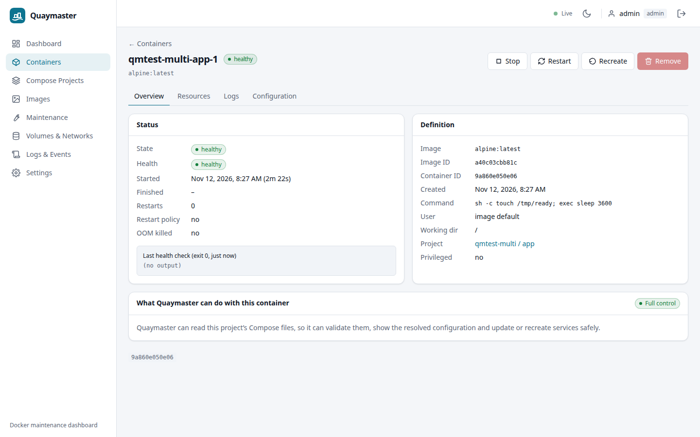
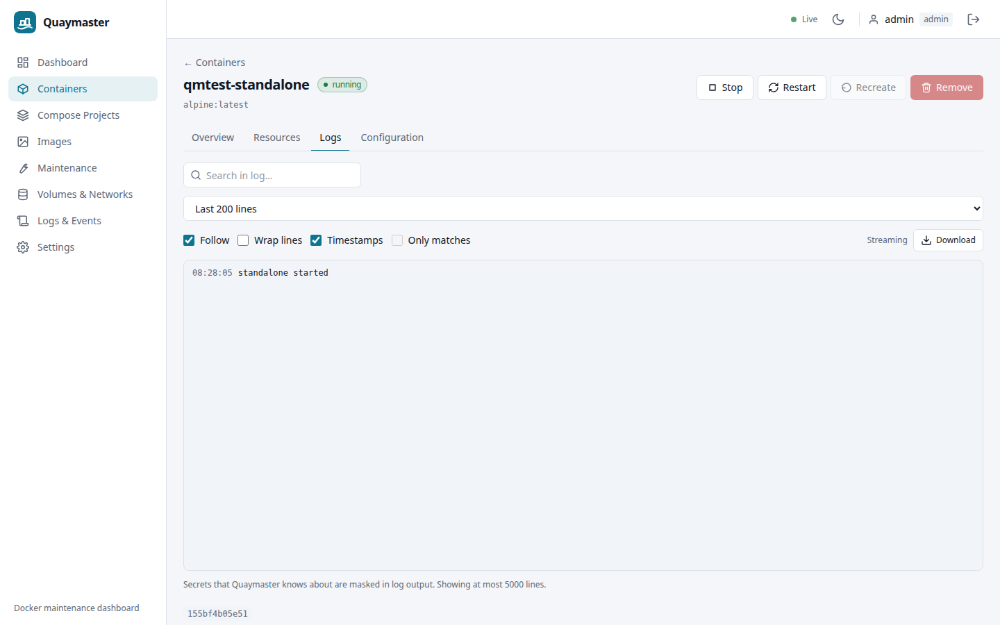
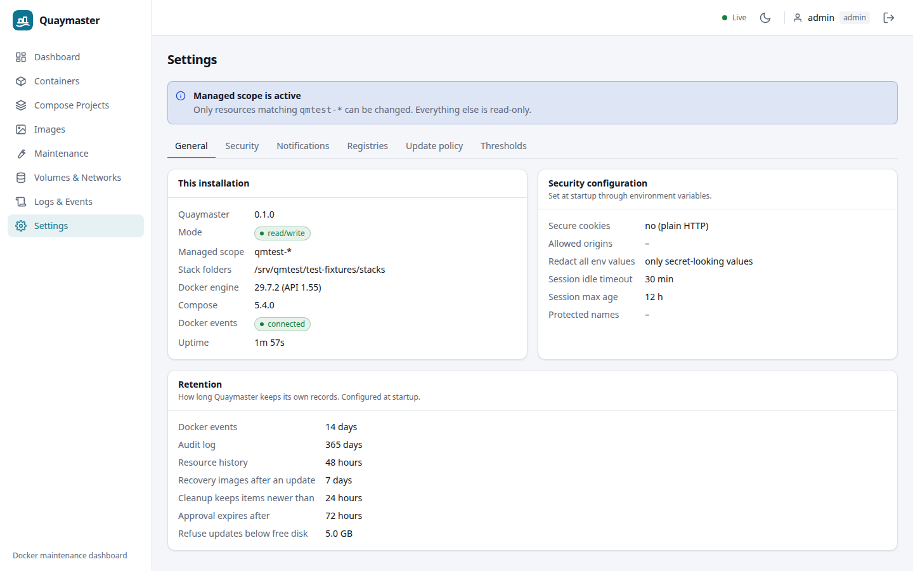
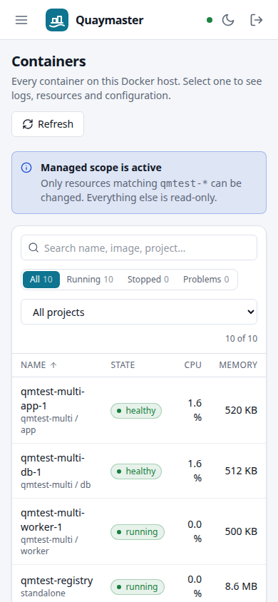

# Quaymaster

Self-hosted dashboard to monitor, manage and safely maintain Docker on a home server:
containers, Compose projects, images, volumes/networks, and scheduled updates with an
audited, health-gated workflow that rolls back on failure.

- Specification: [docs/ARCHITECTURE.md](docs/ARCHITECTURE.md) · API: [docs/API.md](docs/API.md)
- Deployment (container, socket proxy, systemd, TLS, backup/restore, upgrades): [docs/DEPLOY.md](docs/DEPLOY.md)
- Design trade-offs: [docs/DECISIONS.md](docs/DECISIONS.md)

## Quick start

```sh
cp .env.example .env
npm run gen-secret        # QM_SECRET_KEY
npm run hash-password     # QM_ADMIN_PASSWORD_HASH (optional)
docker build -t quaymaster:dev .
docker compose -f deploy/docker-compose.yml up -d   # http://127.0.0.1:8790
```

## Development

`npm test`, `npm run typecheck`, `npm run lint`, `npm run e2e` (Playwright against the fixture environment).

## Screenshots (demo data only)

| | |
|---|---|
|  |  |
|  |  |
|  |  |
|  |  |
|  |  |
